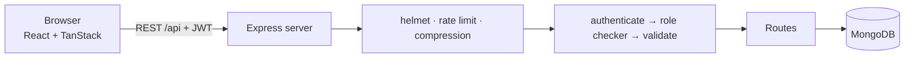

# ProjectBoard — Project Management & Team Collaboration Tool

> A full-stack web app where teams plan projects, assign tasks, track deadlines and talk about the work, with role-based access for admins, managers and members.

**Built by Team Tech Titan** · University project

---

## Team Tech Titan

| Name | Role |
|---|---|
| **Aabid Husain** | Team Leader |
| Sohit | Member |
| Faizul | Member |
| Arun | Member |
| Kaushal | Member |
| Pramit | Member |

---

## Why ProjectBoard?

Small teams often run work through chat groups and spreadsheets. Tasks get lost, nobody knows who owns what, and deadlines slip silently. ProjectBoard puts everything in one place:

- Every task has an owner, a priority, a due date and a comment thread.
- Managers control the plan; members update progress; admins control access.
- A built-in activity log shows who changed what, and when.

## Features

**Everyone sees their own work first**
- **My tasks**: one board with everything assigned to you across all projects (the landing page for members)
- Members can **view** every project and task, but can **only update tasks assigned to them** (move them, comment). Everyone else's tasks are view-only. This is enforced by the server, not just hidden in the UI

**Notifications**
- Bell icon with an unread counter; click a notification to jump straight to the task
- You are notified when a task is assigned to you or taken away, when someone changes its status, priority or due date, when someone comments on it, when it is deleted, or when your role changes
- The person who created a task is told when it is moved to Done or commented on
- Automatic reminders for tasks due today or tomorrow, and for overdue tasks (each reminder is sent once)

**Rewards**
- Earn **points** when a task assigned to you is completed: 10 / 20 / 30 for low / medium / high priority, **+10** if finished on or before the due date
- **Levels** (Rookie, Contributor, Achiever, Pro, Legend) with a progress bar to the next one
- **Badges** for milestones: first task, 5 and 25 tasks, punctual work, high-priority work, 3 and 7 day streaks, 500 points
- **Streaks** for finishing at least one task per day
- A celebration popup when you earn points, a notification in the bell, and a team **leaderboard**
- Fair by design: each task rewards once (reopening it earns nothing more), points go to the assignee even if a manager marks it Done, and tasks you created for yourself earn nothing

**Projects and tasks**
- Create and delete projects; each project has a Kanban board (To do, In progress, Done)
- Drag and drop cards between columns (instant feedback, automatic rollback if the server refuses)
- Task priority (low, medium, high) and due dates, with **overdue** and **due soon** highlighting
- Assign tasks to teammates; comment on tasks
- Task descriptions and checklists (assignees manage the checklist of their own tasks)
- Export a project's tasks to CSV for reports (managers and admins)
- Project progress bar and overdue counter
- Search, plus filters for **My tasks**, a specific teammate, or priority
- Boards refresh themselves every few seconds, so teammates see each other's changes

**Accountability**
- **Activity log** per project: who created, moved, assigned, renamed or commented (kept for 90 days)

**Users, roles and security**
- Login with email and password (passwords hashed with bcrypt, sessions use JWT)
- Three roles with a central permission table (see below)
- **Admin panel** to add users, change roles, deactivate or delete accounts, and see usage totals
- Users can change their own password; changing it signs out every older session
- Deactivated users and role changes take effect within seconds, not at the next login

### Roles

| Permission | Member | Manager | Admin |
|---|:-:|:-:|:-:|
| View all projects and tasks | ✓ | ✓ | ✓ |
| Move and comment on tasks **assigned to them** | ✓ | ✓ | ✓ |
| Move and comment on **any** task | | ✓ | ✓ |
| Create or delete tasks and projects | | ✓ | ✓ |
| Rename, assign, set priority, due date and description | | ✓ | ✓ |
| Update the checklist of tasks **assigned to them** | ✓ | ✓ | ✓ |
| Update the checklist of **any** task | | ✓ | ✓ |
| Export a project to CSV | | ✓ | ✓ |
| Manage users and roles (Admin panel) | | | ✓ |

All rules live in one file: `server/src/config/permissions.js`. Permissions ending in `:own` apply only to tasks assigned to the user.

### Reward rules

| Event | Points |
|---|---|
| Complete a low / medium / high priority task | 10 / 20 / 30 |
| On-time bonus (finished on or before the due date) | +10 |

Levels start at 0, 100, 300, 600 and 1000 points. All numbers live in `server/src/config/rewards.js`, so the team can tune them.

## Tech stack

| Layer | Technology |
|---|---|
| Frontend | React 18, Vite, Tailwind CSS v4 |
| State management | TanStack Query (server data), TanStack Store (UI state) |
| Backend | Node.js, Express |
| Database | MongoDB with Mongoose |
| Auth and validation | JWT, bcrypt, Zod |
| Hardening | Helmet, rate limiting, compression, request size limits |

## Architecture



Every protected request passes three checks in order: **authenticate** (valid token, user still active), **role checker** (`can('task:create')`) and **validate** (Zod schema), before it reaches the route handler.

## Getting started

You need **Node.js 18.11+** and **MongoDB** (local install or MongoDB Atlas).

### Run locally

```bash
# 1. Make sure MongoDB is running (MongoDB Community Server on your machine,
#    or a free MongoDB Atlas cluster: put its connection string in server/.env as MONGODB_URI)

# 2. Install everything and start server + client with ONE command
npm install
npm start
```

Open http://localhost:5173. The API runs on port 4000.
To change settings (database address, secret key, timezone used for streaks), copy `server/.env.example` to `server/.env`.

For a production-style run (one server for the API and the built app):

```bash
npm run build
# set JWT_SECRET first (the server refuses to start in production without it)
npm run start:prod
```

### Team accounts

On first start (empty database) these accounts are created:

| Name | Email | Role |
|---|---|---|
| Aabid Husain | aabid@projectboard.dev | Admin |
| Faizul | faizul@projectboard.dev | Manager |
| Sohit Kumar | sohit@projectboard.dev | Member |
| Arun | arun@projectboard.dev | Member |
| Kaushal | kaushal@projectboard.dev | Member |
| Pramit | pramit@projectboard.dev | Member |

The starting passwords are set in `server/src/utils/seed.js`. Everyone should change theirs after the first login (**Account → Change password**). The database starts with no projects or tasks; a manager or admin creates them.

To wipe everything and start again with these six accounts, run `npm run reset-db`. The seed only runs on an empty database, so editing the list later has no effect until you reset.

### Scripts (from the project root)

| Command | What it does |
|---|---|
| `npm start` | Server and client together, with auto-reload |
| `npm run build` | Builds the client into `client/dist` |
| `npm run start:prod` | Production mode: one server serves the API and the built client |
| `npm run reset-db` | Deletes all data and recreates the six team accounts |

## Suggested 5-minute demo

The app starts empty, so build the demo live:

1. **Sign in as Manager (Faizul).** Create a project, add a few tasks, set priorities and due dates, and assign them to different members.
2. **Open a second window and sign in as a Member (Sohit).** The bell shows the new assignments, and **My tasks** shows only his work. Open the project: everything is visible, but other people's cards can't be dragged and their panel says "View only". Move one of his own tasks to Done and watch the points popup appear, then open **Rewards** to show his level, badges and the leaderboard.
3. **Back as Manager.** The bell shows that Sohit finished a task. Open the activity log below the board.
4. **Sign in as another Member (Arun)** to show he can see Sohit's tasks but cannot change them.
5. **Sign in as Admin (Aabid).** Open the Admin panel: add a user, change a role (the user is notified and their screen updates), deactivate an account.
6. **Close with the architecture.** Show the permission file and explain the authenticate, role check, validate pipeline.

## API overview

All routes are under `/api`. Everything except login needs `Authorization: Bearer <token>`.

| Method and path | Who | Purpose |
|---|---|---|
| `POST /auth/login` | Public | Sign in |
| `GET /auth/me` | Any user | Current user and permissions |
| `PATCH /auth/password` | Any user | Change own password |
| `GET /members` | Any user | Active teammates |
| `GET /projects` | Any user | List projects |
| `POST /projects`, `DELETE /projects/:id` | Manager, Admin | Create, delete project |
| `GET /projects/:id/tasks` | Any user | Tasks of a project |
| `GET /tasks/mine` | Any user | Tasks assigned to me, across projects |
| `POST /projects/:id/tasks` | Manager, Admin | Create task |
| `GET /projects/:id/activity` | Any user | Recent activity |
| `PATCH /tasks/:id` | Status: assignee, Manager, Admin. Other fields: Manager, Admin | Update task |
| `DELETE /tasks/:id` | Manager, Admin | Delete task |
| `POST /tasks/:id/comments` | Assignee, Manager, Admin | Add comment |
| `PUT /tasks/:id/checklist` | Assignee, Manager, Admin | Replace the checklist |
| `GET /projects/:id/export` | Manager, Admin | Download tasks as CSV |
| `GET /rewards/me` | Any user | My points, level, streak, badges, history |
| `GET /rewards/leaderboard` | Any user | Ranking by points |
| `GET /notifications` | Any user (own only) | Latest notifications and unread count |
| `PATCH /notifications/:id/read`, `PATCH /notifications/read-all` | Any user (own only) | Mark as read |
| `GET /admin/stats`, `GET/POST /admin/users`, `PATCH/DELETE /admin/users/:id` | Admin | User management |

## Project structure

```
├── package.json            one-command scripts (npm start)
├── server/src
│   ├── config/             env, database, permissions, reward rules
│   ├── models/             User, Project, Task, Activity, Notification, Reward
│   ├── middleware/         auth, roles (role checker), validate, error
│   ├── routes/             auth, admin, members, projects, tasks, notifications
│   ├── schemas.js          Zod validation rules
│   └── utils/              notify, reminders (due-date job), rewards, activity log, seed data
└── client/src
    ├── lib/                api, store, hooks (incl. permission checker), router, helpers
    ├── components/         Icon, Avatar, Brand, Toasts, RewardPopup, NotificationBell, AccountButton
    ├── pages/              Login, Workspace, Admin
    └── features/           Board, TaskCard, TaskPanel, Activity, Rewards
```

## Security notes

- Passwords are hashed (bcrypt) and never returned by the API
- Permissions are enforced on the server for every request, including per task (a member can't touch a task assigned to someone else); the UI only hides buttons
- Rewards can't be farmed: one reward per task, none for self-created tasks, and points are awarded by the server only
- Notifications are private: every query is limited to the signed-in user
- Login attempts are rate limited; all input is validated; request bodies are size limited
- Role changes, deactivation and password changes apply immediately
- In production the server refuses to start without `JWT_SECRET`

## Future scope

Email and push delivery of notifications · file attachments · real-time updates with WebSockets · task subtasks and labels · calendar view · PDF reports · automated tests and CI pipeline

## License

MIT. See [LICENSE](LICENSE).
