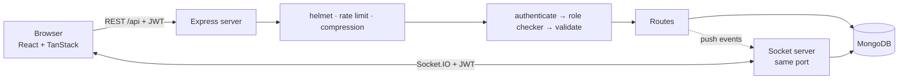

# ProjectBoard — Project Management & Team Collaboration Tool

> A full-stack web app where teams plan projects, assign tasks, track deadlines and talk about the work, with role-based access for admins, managers and members.

**Built by Team Tech Titan** · University project

---

## Team Tech Titan

| Name | Role |
|---|---|
| **Aabid Husain** | Team Leader |
| Sohit | Member |
| Faizul | Member |
| Arun | Member |
| Kaushal | Member |
| Pramit | Member |

---

## Why ProjectBoard?

Small teams often run work through chat groups and spreadsheets. Tasks get lost, nobody knows who owns what, and deadlines slip silently. ProjectBoard puts everything in one place:

- Every task has an owner, a priority, a due date and a comment thread.
- Managers control the plan; members update progress; admins control access.
- A built-in activity log shows who changed what, and when.

## Features

**Everyone sees their own work first**
- **My tasks**: one board with everything assigned to you across all projects (the landing page for members)
- Members can **view** every project and task, but can **only update tasks assigned to them** (move them, comment). Everyone else's tasks are view-only. This is enforced by the server, not just hidden in the UI

**Notifications**
- Bell icon with an unread counter; click a notification to jump straight to the task
- You are notified when a task is assigned to you or taken away, when someone changes its status, priority or due date, when someone comments on it, when it is deleted, or when your role changes
- The person who created a task is told when it is moved to Done or commented on
- Automatic reminders for tasks due today or tomorrow, and for overdue tasks (each reminder is sent once)

**Chat and groups** (real time, built on Socket.IO)
- **Direct messages** with any teammate, and **group chats** that anyone can create (name the group, pick the people)
- Messages appear instantly for everyone in the conversation, with **typing indicators**, **online presence** dots and **unread badges** (also on the sidebar's Chat entry)
- Group owners can rename the group, add or remove people and delete the group; anyone can leave. If the owner leaves, the longest-standing member takes over
- System lines in the thread record who created, renamed, added or removed ("Faizul added Arun")
- People only see messages sent after they joined a group; older messages load 50 at a time
- Private by design: the server only ever pushes a message to the members of its conversation, and non-members get a 404
- If the live connection drops, the app falls back to normal HTTP requests and catches up automatically when it reconnects

**AI Project Assistant** (OpenAI)
- Ask questions in plain English: *what should I focus on today?*, *what is overdue?*, *summarize each project*, *draft my stand-up update*
- Answers come from your team's real projects, tasks and meetings (the server sends the model a compact snapshot with every question), and can be narrowed to one project
- Read-only: it cannot create or change anything. Your OpenAI key stays on the server (`server/.env`), requests are limited to 10 per minute per person, and the feature switches itself off when no key is set

**Meetings** (basic)
- Schedule a meeting with a title, date and time, duration, room or video link, optional project and agenda
- Invite teammates: they get a notification, and again if the meeting is moved or cancelled
- Each person sees only meetings they organize or are invited to; the organizer can add notes (minutes) afterwards and cancel the meeting

**Reports** (managers and admins)
- Totals for tasks, completion rate, overdue tasks, projects and upcoming meetings
- Charts for tasks by status and priority, progress of each project, and workload per person

**Rewards**
- Earn **points** when a task assigned to you is completed: 10 / 20 / 30 for low / medium / high priority, **+10** if finished on or before the due date
- **Levels** (Rookie, Contributor, Achiever, Pro, Legend) with a progress bar to the next one
- **Badges** for milestones: first task, 5 and 25 tasks, punctual work, high-priority work, 3 and 7 day streaks, 500 points
- **Streaks** for finishing at least one task per day
- A celebration popup when you earn points, a notification in the bell, and a team **leaderboard**
- Fair by design: each task rewards once (reopening it earns nothing more), points go to the assignee even if a manager marks it Done, and tasks you created for yourself earn nothing

**Projects and tasks**
- Create and delete projects; each project has a Kanban board (To do, In progress, Done)
- Drag and drop cards between columns (instant feedback, automatic rollback if the server refuses)
- Task priority (low, medium, high) and due dates, with **overdue** and **due soon** highlighting
- Assign tasks to teammates; comment on tasks
- Task descriptions and checklists (assignees manage the checklist of their own tasks)
- Export a project's tasks to CSV for reports (managers and admins)
- Project progress bar and overdue counter
- Search, plus filters for **My tasks**, a specific teammate, or priority
- Boards refresh themselves every few seconds, so teammates see each other's changes

**Accountability**
- **Activity log** per project: who created, moved, assigned, renamed or commented (kept for 90 days)

**Users, roles and security**
- Login with email and password (passwords hashed with bcrypt, sessions use JWT)
- Three roles with a central permission table (see below)
- **Admin panel** to add users, change roles, deactivate or delete accounts, and see usage totals
- Users can change their own password; changing it signs out every older session
- Deactivated users and role changes take effect within seconds, not at the next login

### Roles

| Permission | Member | Manager | Admin |
|---|:-:|:-:|:-:|
| View all projects and tasks | ✓ | ✓ | ✓ |
| Move and comment on tasks **assigned to them** | ✓ | ✓ | ✓ |
| Move and comment on **any** task | | ✓ | ✓ |
| Create or delete tasks and projects | | ✓ | ✓ |
| Rename, assign, set priority, due date and description | | ✓ | ✓ |
| Update the checklist of tasks **assigned to them** | ✓ | ✓ | ✓ |
| Update the checklist of **any** task | | ✓ | ✓ |
| Export a project to CSV | | ✓ | ✓ |
| Chat with teammates and create groups | ✓ | ✓ | ✓ |
| Schedule meetings and invite people | ✓ | ✓ | ✓ |
| View reports | | ✓ | ✓ |
| Manage users and roles (Admin panel) | | | ✓ |

All rules live in one file: `server/src/config/permissions.js`. Permissions ending in `:own` apply only to tasks assigned to the user.

### Reward rules

| Event | Points |
|---|---|
| Complete a low / medium / high priority task | 10 / 20 / 30 |
| On-time bonus (finished on or before the due date) | +10 |

Levels start at 0, 100, 300, 600 and 1000 points. All numbers live in `server/src/config/rewards.js`, so the team can tune them.

## Tech stack

| Layer | Technology |
|---|---|
| Frontend | React 18, Vite, Tailwind CSS v4 |
| State management | TanStack Query (server data), TanStack Store (UI state) |
| Backend | Node.js, Express |
| AI | OpenAI Chat Completions API (called from the server) |
| Real time | Socket.IO (WebSockets with automatic fallback) |
| Database | MongoDB with Mongoose |
| Auth and validation | JWT, bcrypt, Zod |
| Hardening | Helmet, rate limiting, compression, request size limits |

## Architecture



The chat uses the same login token: the socket handshake is verified like a REST request, and every message sent over it re-checks that the session is still valid. Each user has a private room, and the server emits events only to the rooms of a conversation's members.

Every protected request passes three checks in order: **authenticate** (valid token, user still active), **role checker** (`can('task:create')`) and **validate** (Zod schema), before it reaches the route handler.

## Getting started

You need **Node.js 18.11+** and **MongoDB** (local install or MongoDB Atlas).

### Run locally

```bash
# 1. Make sure MongoDB is running (MongoDB Community Server on your machine,
#    or a free MongoDB Atlas cluster: put its connection string in server/.env as MONGODB_URI)

# 2. Install everything and start server + client with ONE command
npm install
npm start
```

Open http://localhost:5173. The API runs on port 4000.
To change settings (database address, secret key, timezone used for streaks), copy `server/.env.example` to `server/.env`. To turn on the AI assistant, put your key in that file as `OPENAI_API_KEY=...` and restart the server (`OPENAI_MODEL` is optional; the default is `gpt-4o-mini`). Never commit `.env` (it is already in `.gitignore`).

For a production-style run (one server for the API and the built app):

```bash
npm run build
# set JWT_SECRET first (the server refuses to start in production without it)
npm run start:prod
```

### Team accounts

On first start (empty database) these accounts are created:

| Name | Email | Role |
|---|---|---|
| Aabid Husain | aabid@projectboard.dev | Admin |
| Faizul | faizul@projectboard.dev | Manager |
| Sohit Kumar | sohit@projectboard.dev | Member |
| Arun | arun@projectboard.dev | Member |
| Kaushal | kaushal@projectboard.dev | Member |
| Pramit | pramit@projectboard.dev | Member |

The starting passwords are set in `server/src/utils/seed.js`. Everyone should change theirs after the first login (**Account → Change password**). The database starts with no projects or tasks; a manager or admin creates them.

To wipe everything and start again with these six accounts, run `npm run reset-db`. The seed only runs on an empty database, so editing the list later has no effect until you reset.

### Scripts (from the project root)

| Command | What it does |
|---|---|
| `npm start` | Server and client together, with auto-reload |
| `npm run build` | Builds the client into `client/dist` |
| `npm run start:prod` | Production mode: one server serves the API and the built client |
| `npm run reset-db` | Deletes all data and recreates the six team accounts |

## Suggested 5-minute demo

The app starts empty, so build the demo live:

1. **Sign in as Manager (Faizul).** Create a project, add a few tasks, set priorities and due dates, and assign them to different members.
2. **Open a second window and sign in as a Member (Sohit).** The bell shows the new assignments, and **My tasks** shows only his work. Open the project: everything is visible, but other people's cards can't be dragged and their panel says "View only". Move one of his own tasks to Done and watch the points popup appear, then open **Rewards** to show his level, badges and the leaderboard.
3. **Back as Manager.** The bell shows that Sohit finished a task. Open the activity log below the board.
4. **Sign in as another Member (Arun)** to show he can see Sohit's tasks but cannot change them.
5. **Sign in as Admin (Aabid).** Open the Admin panel: add a user, change a role (the user is notified and their screen updates), deactivate an account.
6. **Close with the architecture.** Show the permission file and explain the authenticate, role check, validate pipeline.

## API overview

All routes are under `/api`. Everything except login needs `Authorization: Bearer <token>`.

| Method and path | Who | Purpose |
|---|---|---|
| `POST /auth/login` | Public | Sign in |
| `GET /auth/me` | Any user | Current user and permissions |
| `PATCH /auth/password` | Any user | Change own password |
| `GET /members` | Any user | Active teammates |
| `GET /projects` | Any user | List projects |
| `POST /projects`, `DELETE /projects/:id` | Manager, Admin | Create, delete project |
| `GET /projects/:id/tasks` | Any user | Tasks of a project |
| `GET /tasks/mine` | Any user | Tasks assigned to me, across projects |
| `POST /projects/:id/tasks` | Manager, Admin | Create task |
| `GET /projects/:id/activity` | Any user | Recent activity |
| `PATCH /tasks/:id` | Status: assignee, Manager, Admin. Other fields: Manager, Admin | Update task |
| `DELETE /tasks/:id` | Manager, Admin | Delete task |
| `POST /tasks/:id/comments` | Assignee, Manager, Admin | Add comment |
| `PUT /tasks/:id/checklist` | Assignee, Manager, Admin | Replace the checklist |
| `GET /projects/:id/export` | Manager, Admin | Download tasks as CSV |
| `GET /rewards/me` | Any user | My points, level, streak, badges, history |
| `GET /rewards/leaderboard` | Any user | Ranking by points |
| `GET /notifications` | Any user (own only) | Latest notifications and unread count |
| `PATCH /notifications/:id/read`, `PATCH /notifications/read-all` | Any user (own only) | Mark as read |
| `GET /chat/conversations` | Any user (own only) | My direct chats and groups, with last message and unread count |
| `POST /chat/conversations` | Any user | Start a direct chat `{type:'dm', userId}` or create a group `{type:'group', name, memberIds}` |
| `GET /chat/conversations/:id/messages?before=` | Members | Newest 50 messages, or the 50 before a message id |
| `POST /chat/conversations/:id/messages` | Members | Send a message (HTTP fallback; the app normally uses the socket) |
| `POST /chat/conversations/:id/read` | Members | Mark as read |
| `PATCH /chat/conversations/:id`, `DELETE /chat/conversations/:id` | Group owner | Rename, delete a group |
| `POST /chat/conversations/:id/members` | Group owner | Add people |
| `DELETE /chat/conversations/:id/members/:userId` | Group owner, or yourself | Remove someone, or leave |
| `POST /assistant/chat` | Any user | Ask the AI assistant `{messages, projectId?}` and get `{reply}` |
| `GET /meetings` | Any user (own only) | Meetings I organize or am invited to |
| `POST /meetings` | Any user | Schedule a meeting and invite people |
| `PATCH /meetings/:id`, `DELETE /meetings/:id` | Organizer | Change (incl. notes) or cancel |
| `GET /reports/overview` | Manager, Admin | Task, project and workload statistics |
| `GET /admin/stats`, `GET/POST /admin/users`, `PATCH/DELETE /admin/users/:id` | Admin | User management |

### Socket.IO events

Connect with `io({ auth: { token } })`. Rate limited per connection.

| Direction | Event | Purpose |
|---|---|---|
| Client → server | `message:send` `{conversationId, text}` | Send a message; the callback receives `{ok, message}` or `{ok:false, error}` |
| Client → server | `typing` `{conversationId}` | "I'm typing" (the app throttles it) |
| Server → client | `message:new` | A message was posted in one of your conversations |
| Server → client | `conversation:changed` / `conversation:removed` / `conversation:read` | Membership or name changed; you were removed or the group was deleted; you read it in another tab |
| Server → client | `typing` | Someone is typing in a conversation |
| Server → client | `presence:list` / `presence:update` | Who is online |

## Project structure

```
├── package.json            one-command scripts (npm start)
├── server/src
│   ├── config/             env, database, permissions, reward rules
│   ├── models/             User, Project, Task, Activity, Notification, Reward, Conversation, Message, Meeting
│   ├── middleware/         auth, roles (role checker), validate, error
│   ├── routes/             auth, admin, members, projects, tasks, notifications, rewards, chat, meetings, reports, assistant
│   ├── socket.js           Socket.IO server (auth, sending, typing, presence)
│   ├── schemas.js          Zod validation rules
│   └── utils/              notify, reminders (due-date job), rewards, activity log, seed data, chat service, realtime bridge
└── client/src
    ├── lib/                api, store, hooks (incl. permission checker), router, helpers
    ├── components/         Icon, Avatar, Brand, Toasts, RewardPopup, NotificationBell, AccountButton, Modal, ChatAvatar
    ├── pages/              Login, Workspace, Admin
    └── features/           Board, TaskCard, TaskPanel, Activity, Rewards, Meetings, Reports, Assistant, chat/ (Chat, Thread, NewChat, GroupInfo)
```

## Security notes

- Passwords are hashed (bcrypt) and never returned by the API
- Permissions are enforced on the server for every request, including per task (a member can't touch a task assigned to someone else); the UI only hides buttons
- Rewards can't be farmed: one reward per task, none for self-created tasks, and points are awarded by the server only
- Notifications are private: every query is limited to the signed-in user
- Chats are private: membership is checked on every read, send and typing event, messages are pushed only to members' rooms, and deactivating a user or changing a password closes their live connections
- Login attempts are rate limited; all input is validated; request bodies are size limited
- Role changes, deactivation and password changes apply immediately
- In production the server refuses to start without `JWT_SECRET`

## Future scope

Email and push delivery of notifications · file attachments · live board updates over the socket (boards still poll) · message editing, reactions and file sharing · task subtasks and labels · calendar view · PDF reports · automated tests and CI pipeline

## License

MIT. See [LICENSE](LICENSE).


## Troubleshooting

**Chat shows "Reconnecting…" or nothing loads.** The API server is not running or cannot reach the database. Start `npm start` from the project root and read the first lines of the `api` output: it must say `MongoDB connected` and `API ready on http://localhost:4000`. If it says it could not connect, start MongoDB locally or set `MONGODB_URI` in `server/.env` (for Atlas, also allow your IP under *Network Access*).

**"Please sign in again" right after logging in.** `JWT_SECRET` changed while you were signed in. Sign out and in again.

**The AI Assistant says "Basic mode".** That is expected without an `OPENAI_API_KEY`: it answers from your project data. Add a key to `server/.env` and restart for full AI answers. If OpenAI is down or out of credit, it falls back to basic mode automatically.

**Client and API on different domains.** Set `CLIENT_ORIGIN` on the server to the site's address, and `VITE_API_URL` (and optionally `VITE_SOCKET_URL`) in `client/.env` before building.

## Live updates

Besides chat, the server pushes a small `sync` event over the same socket when tasks, projects, meetings, notifications or people change, and open browsers refetch just that data immediately. Polling stays only as a slow safety net (every 5 minutes while connected, every 10-30 seconds if the socket is down).

## Attendance (OTP)

Every person has a read-only chat called **Project Board OTP**, plus an **Attendance** page in the sidebar.

1. The **admin** opens either one, picks how long the code stays valid (15 minutes to 2 hours) and presses **Send today's OTP**. A 6-digit code is posted in the Project Board OTP chat for everyone.
2. Everyone else types that code into the box under the chat (or on the Attendance page) and is marked **present** for that day, once. Nobody can type into the OTP chat.
3. **Managers and admins** see who is present or absent for any date, and a per-person summary for the month. Everyone can see their own days.

Rules: one OTP per day (sending a new one stops the old one working); days follow `TIMEZONE`; after 8 wrong tries a person must wait 10 minutes. The OTP is visible to everyone in the chat, so it proves someone *has the code*, not that they are physically present: keep the validity short, and send it when people are actually at work.

## AI Assistant history

A conversation with the assistant has no message limit. The app sends the most recent part of it with each question and the model reads the latest 20 messages, so long chats stay fast and cheap. The only remaining limit is 10 questions per minute per person.
